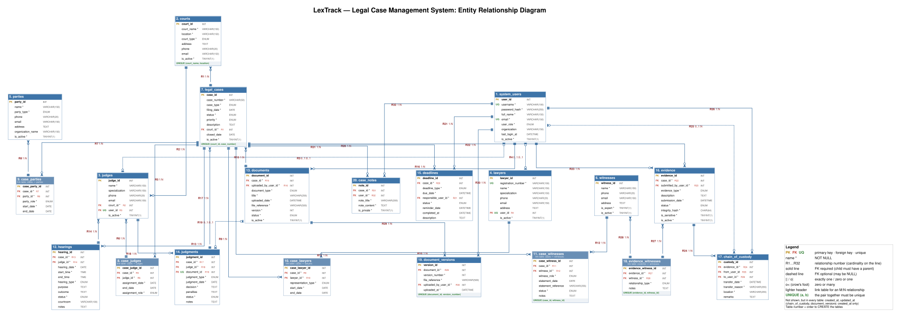
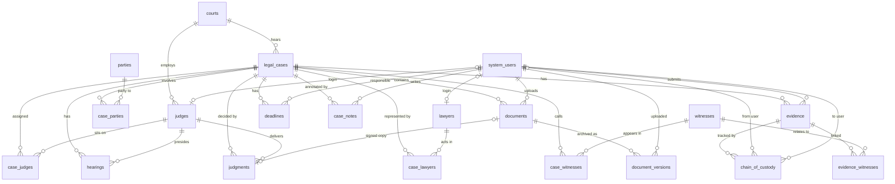

<div align="center">

# ⚖️ LexTrack

### Legal Case Management System

A relational database for managing court cases from filing to judgment. It covers courts, judges, lawyers, parties, hearings, evidence custody, documents, deadlines and judgments. Business rules are enforced **inside the database** with constraints, triggers and stored procedures.


| 20 Tables | 32 Foreign Keys | 44 Triggers | 11 Stored Procedures | 6 Views | 29 Queries |
|:---:|:---:|:---:|:---:|:---:|:---:|

</div>

---

## 📑 Table of Contents

1. [Project Overview](#-project-overview)
2. [Key Features](#-key-features)
3. [Database Architecture](#-database-architecture)
4. [Database Modules](#-database-modules)
5. [Technology Stack](#-technology-stack)
6. [Project Structure](#-project-structure)
7. [Installation and Setup](#-installation-and-setup)
8. [SQL Concepts Demonstrated](#-sql-concepts-demonstrated)
9. [Sample Queries](#-sample-queries)
10. [Data Integrity and Security](#-data-integrity-and-security)
11. [Future Improvements](#-future-improvements)
12. [Academic Project Information](#-academic-project-information)
13. [License](#-license)

---

## 📖 Project Overview

**LexTrack** is the database layer of a legal case management system. It is implemented in MySQL as the `legal_case_db` schema.

### The problem

Court records cover many connected entities. A case passes through several judges, lawyers and parties over time. Evidence changes hands, documents are revised, and judgments go through formal stages. When these records live in spreadsheets or loosely structured systems, several things go wrong:

- assignment history is overwritten and lost
- a judge or courtroom gets double-booked
- evidence custody has gaps or back-dated entries
- finalized judgments are edited or records are deleted

### How the database addresses it

LexTrack models the case lifecycle as a normalized relational schema and pushes the rules into the database itself:

- **History instead of overwrites:** assignments carry `start_date` and `end_date` periods, document versions are archived, and custody is an append-only chain.
- **Refusal of invalid states:** triggers reject overlapping assignments, double-bookings, illegal judgment status changes and edits to locked records.
- **No destructive deletes:** foreign keys use `ON DELETE RESTRICT`, and core records use soft delete through `is_active`.
- **Ready-made reporting:** views and procedures provide dashboards, calendars, deadline trackers and case timelines.

---

## ✨ Key Features

| Module | What the database supports |
|---|---|
| 📁 **Case registration and tracking** | Cases with type, status, priority and filing and closing dates. Case numbers are unique **per court**. Cases are closed through `sp_close_case` and archived through soft delete. |
| 🏛️ **Court and judge management** | Courts by type and location. Each judge belongs to one court and can only be assigned to cases in that court. Roles are Presiding, Associate, Bench Member and Substitute, with **one active Presiding judge per case**. |
| 👩‍⚖️ **Lawyer and party management** | Lawyers have unique registration numbers. Parties can be an individual, an organization or a government. Each lawyer and party is linked to a case with a role and a dated period, and periods cannot overlap. |
| 📅 **Hearing scheduling** | Hearings have a date, start and end time, type, courtroom and status. The judge must be assigned to the case on the hearing date. **No double-booking** of a judge or a courtroom. |
| 🔒 **Evidence and chain of custody** | Each evidence item stores a SHA-256 `integrity_hash`. An intake custody record is created automatically. Transfers form an **unbroken, append-only chain**, and the current location is derived through a view. |
| 🧑‍🤝‍🧑 **Witness management** | Witnesses (expert or non-expert) are linked to cases with a role, statement reference and status, and can be linked to specific evidence items. |
| 📄 **Document and version management** | Uploading a new file raises the version automatically, and the previous file is archived in the append-only `document_versions` table. |
| 🧾 **Judgment management** | Judgments move through a controlled status flow (Draft → Pronounced → Appealed → …). Content is locked once a judgment is no longer a Draft. A judgment can optionally link one signed Judgment or Order document. |
| ⏰ **Deadline tracking** | Deadlines have a type, due date, reminder date, responsible user and status. A view computes days left and an overdue flag. |
| 👤 **Users and internal case notes** | System users have the roles Admin, Judge, Lawyer, Clerk, Registrar or Viewer. Users can write internal case notes, which are flagged as private or shared. |

---

## 🏗️ Database Architecture

### Design summary

- **20 tables** in InnoDB with `utf8mb4` character set, linked by **32 foreign-key relationships**
- Every foreign key uses `ON DELETE RESTRICT ON UPDATE CASCADE`, so legal records are never cascade-deleted
- Every table has `created_at`. All tables except the append-only ones also have `updated_at`.
- Fixed value lists are `ENUM`s, and yes/no flags are `TINYINT(1)` with `CHECK (... IN (0,1))`
- Soft delete (`is_active`) on master tables, cases, documents and evidence

### Table groups

| Group | Tables |
|---|---|
| **Master** | `system_users`, `courts`, `judges`, `lawyers`, `parties`, `witnesses` |
| **Core** | `legal_cases` |
| **Junction (M:N)** | `case_judges`, `case_parties`, `case_lawyers`, `case_witnesses`, `evidence_witnesses` |
| **Case activity** | `hearings`, `documents`, `document_versions`, `judgments`, `deadlines`, `case_notes` |
| **Evidence** | `evidence`, `chain_of_custody` |

### Entity-relationship diagram

The full diagram shows every table with its columns, keys, `NOT NULL` markers and composite `UNIQUE` rules. It was generated from the final database, so it matches [`Database/schema.sql`](Database/schema.sql) exactly.



<sub>Open in full size: [SVG](ER_diagram.svg) · [PDF (for printing)](ER_diagram.pdf) · [PNG](ER_diagram.png) · Why each table is connected (R1–R32), with cardinality and solid/dashed reasoning: [ER_relationships.png](ER_relationships.png)</sub>

**How to read it:** table numbers give the order in which the tables are created. R1–R32 label the 32 foreign-key relationships. A solid line is a required foreign key and a dashed line is an optional (nullable) one. Crow's feet mark the "many" side, and the lighter headers mark junction tables for M:N relationships.

#### Simplified relationship view

> The diagram below is generated from the same foreign keys and rendered natively by GitHub (Mermaid).



### Important relationships

| Relationship | Cardinality | How it is modelled |
|---|---|---|
| Court → Cases / Judges | 1 : N | `legal_cases.court_id`, `judges.court_id` |
| Case ↔ Judge / Party / Lawyer / Witness | M : N | Junction tables with role, dates and period-overlap checks |
| Evidence ↔ Witness | M : N | `evidence_witnesses`; the witness must be registered on the same case |
| Judge / Lawyer ↔ System user | 1 : 1 (optional) | Nullable `user_id` with a `UNIQUE` constraint |
| Judgment ↔ Document | 1 : 1 (optional) | Nullable `judgments.document_id` with a `UNIQUE` constraint |
| Evidence → Custody records | 1 : N | Append-only `chain_of_custody`; `from_user_id` is NULL only for the intake entry |
| Document → Versions | 1 : N | `document_versions`, unique on `(document_id, version_number)` |

### Keys

- **Primary keys:** every table uses a surrogate `INT AUTO_INCREMENT` primary key.
- **Foreign keys:** there are 32, all named (`fk_*`), all `RESTRICT` on delete.
- **Natural / business keys:** enforced as named `UNIQUE` constraints:
  - `username` and `email`
  - `(court_name, location)`
  - lawyer `registration_number`
  - `(court_id, case_number)`
  - `(case_id, witness_id)` and `(evidence_id, witness_id)`
- **Junction tables** use a surrogate key instead of a composite key. One judge, party or lawyer can be assigned to the same case more than once over **different, non-overlapping periods**, which keeps the full assignment history.

---

## 🧩 Database Modules

All scripts are in the [`Database/`](Database/) folder and are numbered *file 1 of 7* to *file 7 of 7* in their headers.

| # | File | Purpose |
|:-:|---|---|
| 1 | [`schema.sql`](Database/schema.sql) | Creates `legal_case_db` and all 20 tables with primary keys, foreign keys, `UNIQUE`, `CHECK` and `ENUM` constraints, and indexes. It is a first-time install only: it never drops data. |
| 2 | [`procedures.sql`](Database/procedures.sql) | 11 stored procedures. **Part A** has 3 helpers that the triggers call: active user, active case, and hearing-slot check. **Part B** has 8 everyday procedures: open case, assign judge, schedule hearing, transfer evidence, complete deadline, close case, lawyer's cases and case timeline. |
| 3 | [`triggers.sql`](Database/triggers.sql) | 44 triggers that enforce the business rules: no hard deletes, append-only history, locked provenance, judgment status flow, assignment periods, hearing double-booking checks, and rejection of inactive records. |
| 4 | [`sample_data.sql`](Database/sample_data.sql) | Realistic demo data for 3 courts, 5 judges, 6 lawyers, 8 parties, 6 witnesses, 7 cases and 13 users, plus hearings, documents, judgments, deadlines, evidence, custody transfers and notes. Every insert passes the trigger rules. |
| 5 | [`views.sql`](Database/views.sql) | 6 views. Two derived-value views: next hearing per case, and current evidence location. Four report views: hearing calendar, pending deadlines, case summary dashboard, and lawyer workload. |
| 6 | [`queries.sql`](Database/queries.sql) | 29 read-only queries (Q1–Q29). They cover filtering, joins, aggregation, subqueries, CTEs, window functions, `CASE`, views, procedure calls, and an installation check. |
| 7 | [`transactions.sql`](Database/transactions.sql) | 7 transaction demos: `COMMIT`, `ROLLBACK`, `SAVEPOINT`, automatic rollback on error, a rolled-back evidence transfer, a refused rule violation, and a manual two-session row-locking demo. |

---

## 🛠️ Technology Stack

| Component | Details |
|---|---|
| **Database** | MySQL **8.0.16 or newer** |
| **Storage engine** | InnoDB (transactions, row-level locking, foreign keys) |
| **Character set** | `utf8mb4` / `utf8mb4_unicode_ci` |
| **Language** | SQL: DDL, DML, stored procedures, triggers, views |
| **Client tools** | MySQL Command-Line Client or MySQL Workbench (any client that supports `DELIMITER`) |

> **Why 8.0.16+?** `CHECK` constraints are only enforced from MySQL 8.0.16. The project also uses CTEs, window functions (`ROW_NUMBER`, `RANK`, `LAG`) and `SELECT ... FOR SHARE`, which need MySQL 8.0.

---

## 📂 Project Structure

```text
LexTrack – Legal Case Management System/
├── README.md
├── ER_diagram.svg          # full ER diagram (vector, sharp at any zoom)
├── ER_diagram.pdf          # same diagram, for printing
├── ER_diagram.png          # same diagram, high-resolution image
├── ER_relationships.png    # R1–R32: cardinality and reason for every relationship
└── Database/
    ├── schema.sql          # 1. database, 20 tables, keys, constraints, indexes
    ├── procedures.sql      # 2. 11 stored procedures (3 trigger helpers + 8 app procedures)
    ├── triggers.sql        # 3. 44 business-rule triggers
    ├── sample_data.sql     # 4. demo data (passes every trigger rule)
    ├── views.sql           # 5. 6 derived-value and report views
    ├── queries.sql         # 6. 29 read-only demonstration queries
    └── transactions.sql    # 7. 7 transaction / concurrency demos
```

---

## 🚀 Installation and Setup

### 1. Install MySQL

Download and install **MySQL Community Server 8.0.16 or newer** from the [official MySQL downloads page](https://dev.mysql.com/downloads/mysql/). On Windows, the MySQL Installer can also install **MySQL Workbench**.

Check the installed version:

```bash
mysql --version
```

### 2. Run the scripts in dependency order

> ⚠️ **The order matters.** The triggers call the helper procedures, so `procedures.sql` must run **before** `triggers.sql`. The sample data must be inserted **after** the triggers, so that every row is validated.

```text
schema.sql → procedures.sql → triggers.sql → sample_data.sql → views.sql → queries.sql → transactions.sql
```

`schema.sql` creates the `legal_case_db` database itself, so you do not need to create it by hand.

**Option A: MySQL Command-Line Client (works in any terminal)**

Open a terminal **inside the `Database` folder**, then start the client:

```bash
mysql -u root -p
```

At the `mysql>` prompt, run:

```sql
SOURCE schema.sql;
SOURCE procedures.sql;
SOURCE triggers.sql;
SOURCE sample_data.sql;
SOURCE views.sql;
```

**Option B: Shell redirection (Bash / Git Bash / Command Prompt)**

```bash
cd Database
mysql -u root -p < schema.sql
mysql -u root -p < procedures.sql
mysql -u root -p < triggers.sql
mysql -u root -p < sample_data.sql
mysql -u root -p < views.sql
```

> PowerShell does not support `<` input redirection. Use Option A there.

**Option C: MySQL Workbench**

Open each file in the order above with **File → Open SQL Script** and run it with **Execute (⚡)**.

### 3. Load sample data

Sample data is loaded by `sample_data.sql` in step 2. It is meant to run **once, on a fresh database**, because it inserts fixed primary-key values.

### 4. Verify the installation

Run query **Q29** from `queries.sql`:

```sql
USE legal_case_db;

SELECT
  (SELECT COUNT(*) FROM information_schema.tables   WHERE table_schema = 'legal_case_db' AND table_type = 'BASE TABLE') AS tables_count,
  (SELECT COUNT(*) FROM information_schema.tables   WHERE table_schema = 'legal_case_db' AND table_type = 'VIEW')       AS views_count,
  (SELECT COUNT(*) FROM information_schema.triggers WHERE trigger_schema = 'legal_case_db')                             AS triggers_count,
  (SELECT COUNT(*) FROM information_schema.routines WHERE routine_schema = 'legal_case_db' AND routine_type = 'PROCEDURE') AS procedures_count;
```

**Expected result:** `20` tables, `6` views, `44` triggers, `11` procedures.

### 5. Explore

```sql
SOURCE queries.sql;        -- read-only; safe to run any number of times
SOURCE transactions.sql;   -- demos 1 and 3 add one deadline and one note on each run
```

> 💡 Several views and queries compare records against `NOW()` / `CURRENT_DATE`, for example upcoming hearings and overdue deadlines. Their results depend on the date when you run them.

### Rebuilding from scratch

`schema.sql` never drops existing tables. To reinstall on a test machine:

```sql
DROP DATABASE legal_case_db;
```

Then repeat step 2.

---

## 🎓 SQL Concepts Demonstrated

| Concept | Where and how |
|---|---|
| **Normalization** | Each entity has its own table, and M:N relationships are split into junction tables. Derived values are computed by views instead of being stored: the next hearing (`v_case_next_hearing`) and the current evidence location (`v_evidence_current_location`). Expert status is stored once, on `witnesses`. |
| **Relationships and cardinality** | 1:N (court → cases), M:N (case ↔ judge/party/lawyer/witness, evidence ↔ witness), and optional 1:1 (user ↔ judge/lawyer, judgment ↔ document). |
| **Constraints and referential integrity** | `PRIMARY KEY`, 32 named `FOREIGN KEY`s with `RESTRICT`, `UNIQUE`, `NOT NULL`, `DEFAULT`, `ENUM`. `CHECK` constraints cover date order, hearing times, document version ≥ 1, the deadline completion rule and the SHA-256 hash format. |
| **Joins** | `INNER JOIN`, `LEFT JOIN … IS NULL` (anti-join), joining the same table twice under different aliases (chain of custody), and joining a view (Q4–Q8). |
| **Subqueries** | `EXISTS`, `NOT IN`, correlated subqueries, derived tables, and scalar subqueries in a `SELECT` list (Q12–Q17). |
| **Aggregation** | `GROUP BY`, `HAVING`, `COUNT`, `SUM` over boolean expressions, `AVG` (Q9–Q13). |
| **CTEs and window functions** | `WITH`, `ROW_NUMBER()`, `RANK()`, `LAG()` (Q18–Q20). |
| **Set operations** | `UNION ALL` in the document version history (Q22) and in `sp_case_timeline`. |
| **Views** | 6 views for derived values and reporting dashboards. |
| **Stored procedures** | `IN` / `OUT` parameters, `SIGNAL SQLSTATE '45000'` for custom errors, `DECLARE EXIT HANDLER … ROLLBACK; RESIGNAL`. |
| **Triggers** | 44 `BEFORE` / `AFTER` `INSERT` / `UPDATE` / `DELETE` triggers. They validate data, block deletes, compute values automatically (document version) and write audit rows automatically (custody intake, archived document versions). |
| **Transactions** | `START TRANSACTION`, `COMMIT`, `ROLLBACK`, `SAVEPOINT` / `ROLLBACK TO SAVEPOINT`, and an error handler that rolls back. Each demo shows one of the ACID properties. |
| **Concurrency control** | `SELECT … FOR UPDATE` / `FOR SHARE` locks serialize hearing bookings and custody transfers. Demo 7 shows the locking with two sessions. |
| **Indexing** | Composite indexes for common lookups: assignment periods (`idx_cj_period`, `idx_cp_period`, `idx_cl_period`), hearing slots (`idx_hearings_judge_slot`, `idx_hearings_room_slot`, `idx_hearings_case_date`), deadlines (`idx_deadlines_status_due`) and custody history (`idx_coc_evidence_date`). |

---

## 🔍 Sample Queries

The following are taken directly from [`Database/queries.sql`](Database/queries.sql).

**Q4: Each case with its court and current presiding judge (INNER JOINs)**

```sql
SELECT c.case_number, ct.court_name, ct.location, j.name AS presiding_judge
FROM legal_cases c
JOIN courts ct      ON ct.court_id = c.court_id
JOIN case_judges cj ON cj.case_id = c.case_id
                   AND cj.assignment_role = 'Presiding'
                   AND cj.end_date IS NULL
JOIN judges j       ON j.judge_id = cj.judge_id
ORDER BY c.case_number;
```

**Q8: Full chain of custody for evidence item 1**

```sql
SELECT coc.transfer_date, giver.full_name AS from_person, taker.full_name AS to_person,
       coc.transfer_reason, coc.location
FROM chain_of_custody coc
LEFT JOIN system_users giver ON giver.user_id = coc.from_user_id
JOIN system_users taker      ON taker.user_id = coc.to_user_id
WHERE coc.evidence_id = 1
ORDER BY coc.transfer_date, coc.custody_id;
```

**Q10: Lawyers handling more than one active case (GROUP BY + HAVING)**

```sql
SELECT l.name, COUNT(*) AS active_cases
FROM case_lawyers cl
JOIN lawyers l ON l.lawyer_id = cl.lawyer_id
WHERE cl.end_date IS NULL
GROUP BY l.lawyer_id, l.name
HAVING COUNT(*) > 1
ORDER BY active_cases DESC;
```

**Q19: Rank lawyers by current caseload (CTE + RANK)**

```sql
WITH load_per_lawyer AS (
    SELECT l.lawyer_id, l.name, COUNT(cl.case_lawyer_id) AS active_cases
    FROM lawyers l
    LEFT JOIN case_lawyers cl ON cl.lawyer_id = l.lawyer_id AND cl.end_date IS NULL
    GROUP BY l.lawyer_id, l.name
)
SELECT name, active_cases, RANK() OVER (ORDER BY active_cases DESC) AS caseload_rank
FROM load_per_lawyer;
```

**Q20: Gap in days between consecutive hearings (LAG)**

```sql
SELECT c.case_number, h.hearing_date,
       DATEDIFF(h.hearing_date, LAG(h.hearing_date) OVER (PARTITION BY h.case_id ORDER BY h.hearing_date)) AS days_since_previous
FROM hearings h
JOIN legal_cases c ON c.case_id = h.case_id
WHERE h.status <> 'Cancelled'
ORDER BY c.case_number, h.hearing_date;
```

**Views and stored procedures**

```sql
SELECT * FROM v_case_summary;                                     -- Q23: case dashboard
SELECT * FROM v_upcoming_hearings ORDER BY hearing_date, start_time; -- Q24: hearing calendar
CALL sp_lawyer_cases(1);                                          -- Q27: "My Cases" for lawyer 1
CALL sp_case_timeline(1);                                         -- Q28: full timeline of case 1
```

---

## 🛡️ Data Integrity and Security

### ✅ Implemented in the database

**Record preservation**
- `legal_cases`, `documents`, `evidence`, `judgments` and the assignment tables (`case_judges`, `case_lawyers`, `case_parties`) **cannot be deleted**. Triggers reject `DELETE` and ask for soft delete (`is_active = 0`) or an `end_date` instead.
- Archived cases and inactive users, judges, lawyers, parties, witnesses and courts **cannot be referenced by new records**.

**Evidence integrity and chain of custody**
- `integrity_hash` must be a 64-character hexadecimal string (SHA-256 format, enforced by `CHECK`).
- The hash, owning case, submitter and submission time are **immutable after insert**.
- Every new evidence item gets an **automatic intake custody record**.
- Each custody transfer must start from the **current holder**, cannot be back-dated, and cannot transfer to the same person.
- `chain_of_custody` is **append-only**: updates and deletes are blocked.

**Documents and judgments**
- A new `file_reference` automatically increases `version`, and the old file is saved to the append-only `document_versions` table.
- A document's case and type are locked after filing.
- Judgment status follows a fixed flow: `Draft → Pronounced | Voided`, `Pronounced → Appealed | Voided`, `Appealed → Pronounced | Overturned | Voided`.
- Judgment content is locked once it leaves `Draft`.
- A linked document must be a Filed or Accepted Judgment or Order from the same case.

**Assignments and scheduling**
- Assignment periods for the same case cannot overlap, and history is locked: only `end_date` can be set, once.
- Only one active Presiding judge per case, and the judge must come from the case's own court.
- Hearings and judgments require the judge to be assigned to the case on that date.
- Judges and courtrooms cannot be double-booked.

**Audit-related mechanisms**
- `created_at` and `updated_at` timestamps on every table (`created_at` only on the append-only tables).
- History is preserved through the append-only custody chain, the archived document versions and the dated assignment records.

### ⚠️ Expectations and application responsibilities (not enforced by the database)

- **Password hashing:** `system_users.password_hash` (`VARCHAR(255)`) only stores the hash. The application must hash passwords, for example with bcrypt or Argon2, before inserting them. The values in `sample_data.sql` are **placeholders, not real hashes**.
- **Evidence hashing:** the database checks the hash *format* but does not compute or verify the hash against a file. The application must generate the SHA-256 hash of the evidence file.
- **Access control:** `user_role` records a user's role, but the scripts define **no MySQL accounts, `GRANT`s or row-level security**. Permissions must be enforced by an application layer.
- **Private notes:** `case_notes.is_private` is a flag. As the schema comments note, hiding private notes from other users is the application's job.
- **Audit log:** there is **no general-purpose audit-log table** that records who changed what and when.

---

## 🔮 Future Improvements

These are suggestions and are **not implemented**:

- A dedicated **audit-log table**, filled by triggers, recording the user, action, old values and new values for every change
- **MySQL roles and `GRANT`-based privileges** that match `user_role`, for least-privilege access
- An **application layer**, such as a web front end or REST API, that handles authentication, password hashing and role-based screens
- **File storage integration** that computes and re-verifies evidence SHA-256 hashes
- **Automated tests** that run every trigger rule against expected success and failure cases
- **Scheduled events** that mark overdue deadlines as `Missed` and send reminders on `reminder_date`
- **Full-text indexes** on case descriptions and documents for faster keyword search
- **Query output screenshots** for documentation

---

## 🏫 Academic Project Information

LexTrack was developed as an **undergraduate Database Management Systems (DBMS) project**. It demonstrates relational schema design, integrity constraints, triggers, stored procedures, views, complex queries and transaction management on a realistic legal domain.

| | |
|---|---|
| **Institute** | Thapar Institute of Engineering and Technology, Patiala |
| **Course** | Database Management Systems (`COURSE_CODE`) |
| **Instructor** | `INSTRUCTOR_NAME` |
| **Developed by** | Harshita Shibe (`ROLL_NUMBER`) |
| **Academic year** | 2026–27 |

> The people, contact details and cases in `sample_data.sql` are for demonstration only.

---

## 📜 License

No license has been specified for this project yet. Until a license is added, all rights are reserved by the author(s).

---

<div align="center">

**⚖️ LexTrack** · Built with MySQL 8

</div>
